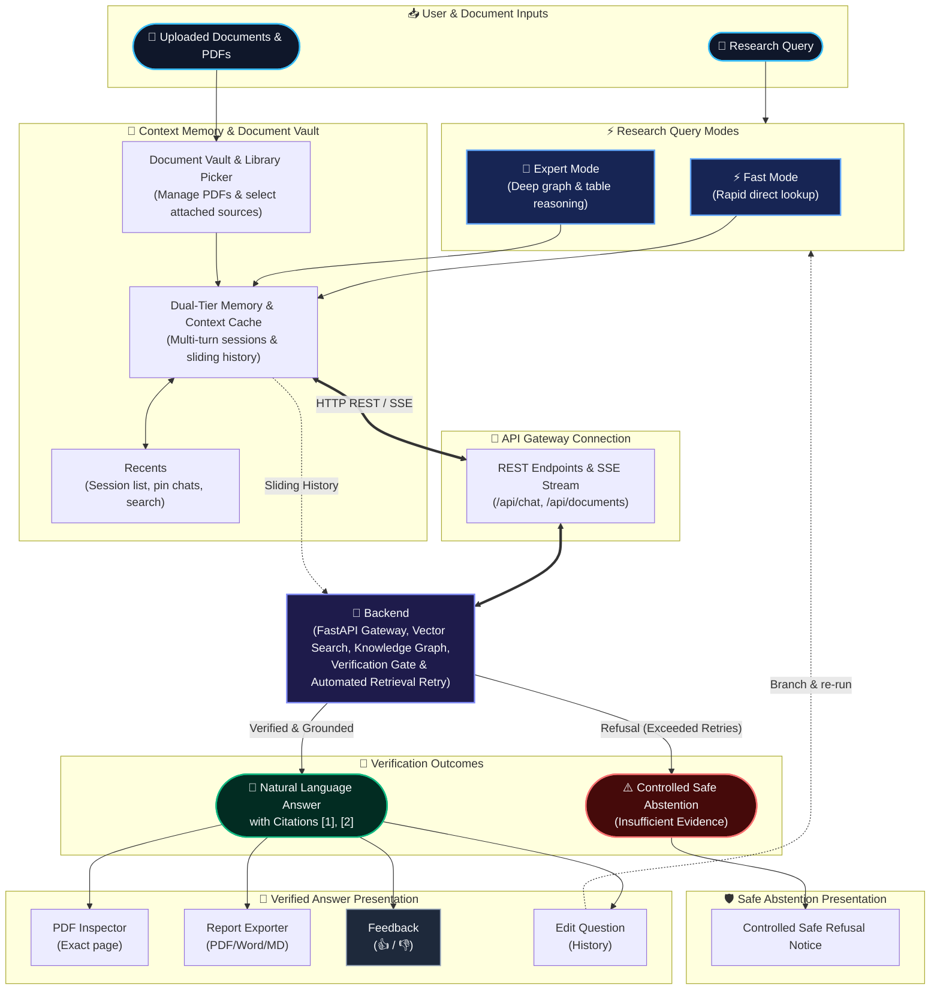

# 🏛️ RAISE: Research Assessment Intelligence & Semantic Extraction

Welcome to the frontend of **RAISE** — an academic research interface designed to help researchers, students, and analysts submit research queries, upload institutional PDF documents and patents, inspect exact page-level citations, and export publication-ready reports.

---

## ⚙️ Core System Architecture & Information Flow

The frontend coordinates user queries, attached source documents, live streaming responses, and document citation verification with the central **Backend**.



---

## 2. Frontend System Design

Here is how each component of the interface functions:

### ⚡ Dual Research Modes

| ⚡ Fast Mode | 🔬 Expert Mode |
| :--- | :--- |
| **Focus**: Rapid direct lookup, instant fact checks, and quick skimming. | **Focus**: Deep multi-hop knowledge graph reasoning & tables. |
| **Search Substrate**: Lightweight 1-hop search across dense vectors & keywords. | **Search Substrate**: Full 3-hop Neo4j graph traversal + Docling table parser. |
| **Latency**: Sub-second initial token streaming with minimal compute. | **Latency**: Deep cross-attention ranking and multi-page evidence synthesis. |
| **Best Used For**: Straightforward questions answered within a single excerpt. | **Best Used For**: Complex audits connecting facts across distant chapters. |

---

### 🧩 Core Architectural Subsystems

- **Client Context & Dual-Tier Memory**:
  - Maintains multi-turn conversation context and sliding history across query refinements.
  - Houses the local **Document Vault** to attach and manage PDF files per research session.
  - Automatically preserves conversation sessions in **Recents** with instant search, pinning, and recall.

- **Gateway Connection & Streaming Engine**:
  - Communicates via strict REST endpoints (`/api/chat`, `/api/documents`) and **Server-Sent Events (SSE)**.
  - Streams tokens with live incremental rendering and sub-second first-chunk response times.

- **Grounding Verification & Presentation**:
  - **PDF Page Inspector**: Resolves inline citation badges (`[1]`, `[2]`) to exact bounding coordinates on document pages.
  - **Institutional Exporter**: Formats verified findings into ISO A4 PDF, Word (`.docx`), and Markdown reports with full provenance tables.
  - **Feedback & Branching**: Instant evaluation (`👍 / 👎`) and prior-turn query branching for iterative research exploration.
  - **Safe Abstention on Missing Evidence**: Explicit notification when evidence is absent from indexed sources without speculative answers.

---

## 📌 Important: Understanding Branches vs Folders

To avoid confusion between repository branches and directories:

* 🌿 **`frontend` (Standalone Git Branch)**:
  This branch contains the standalone React 19 workstation at the **root level** (with `src/`, `public/`, `package.json`, and one-click startup scripts `START_RAISE_FRONTEND.*`).
* 📁 **`frontend/` (Subfolder on `main` Branch)**:
  The `main` branch is the monorepo that packages `frontend/` and `backend/` side-by-side, coordinated by root full-pipeline scripts (`START_RAISE.*`).
* 🌿 **`backend` (Standalone Git Branch)**:
  The Python FastAPI and GraphRAG pipeline live in their own standalone branch.

---

## 3. How to Run the Application

### Step 0: Get the Code
Choose how you would like to obtain the frontend:

- **Option A (Direct ZIP Download — Recommended)**:
  Click [📥 **Download frontend.zip**](https://github.com/semanticClimate/RAISE/archive/refs/heads/frontend.zip) to download this branch directly. Extract the `.zip` file on your computer and open the folder.

- **Option B (Clone via Git)**:
  ```bash
  git clone -b frontend https://github.com/semanticClimate/RAISE.git
  cd RAISE
  ```

---

There are two ways to start the RAISE frontend interface:
1. **One-Click Portable Launch** (Zero configuration — automatic background setup)
2. **Standard Developer Setup** (Using Node.js and NPM)

---

### Method 1: One-Click Portable Launch (Zero Configuration)

Run or download the single startup script for your operating system. If run inside the repository, it launches immediately; if run on its own, it automatically downloads the workspace and dependencies in the background:

| Operating System | Startup Script (Click to Download) | How to Launch | What the Script Automatically Does |
| :--- | :--- | :--- | :--- |
| **Windows** | [**`START_RAISE_FRONTEND.bat`**](https://raw.githubusercontent.com/semanticClimate/RAISE/frontend/START_RAISE_FRONTEND.bat) | Double-click the file in Windows Explorer. | Checks workspace files, verifies Node.js (or downloads portable LTS into `.node/` if missing), installs dependencies if needed, and launches the browser at `http://localhost:5173`. |
| **macOS (Finder)** | [**`START_RAISE_FRONTEND.command`**](https://raw.githubusercontent.com/semanticClimate/RAISE/frontend/START_RAISE_FRONTEND.command) | Double-click the file in macOS Finder. *(If prompted, right-click and select "Open")*. | Automatically detects Apple Silicon or Intel architecture, verifies workspace files, configures tools in the background, and opens your browser. |
| **Linux / Unix** | [**`START_RAISE_FRONTEND.sh`**](https://raw.githubusercontent.com/semanticClimate/RAISE/frontend/START_RAISE_FRONTEND.sh) | Run `chmod +x START_RAISE_FRONTEND.sh && ./START_RAISE_FRONTEND.sh` in terminal. | Detects Linux distribution architecture (`x86_64` or `arm64`), checks files, sets up runtime in the background, and boots the development server cleanly. |

---

### Method 2: Standard Developer Setup (Node.js & NPM)

If you are developing or testing the interface using standard command-line tools:

#### 1. Prerequisites
Ensure you have **Node.js** (version 20 or higher recommended) and **npm** installed:
```bash
node -v
npm -v
```
*(If you need to install Node.js, download the official LTS installer from [https://nodejs.org/](https://nodejs.org/)).*

#### 2. Install Project Dependencies
Open your terminal in the `frontend/` folder and run:
```bash
npm install
```

#### 3. Start the Interactive Development Server
To launch the interface with instant hot-module reloading:
```bash
npm run dev
```
Open your web browser and navigate to:
```
http://localhost:5173
```

#### 4. Build for Production
To generate an optimized, high-performance production build:
```bash
npm run build
```
The compiled, minified assets will be created in the `dist/` directory, ready to be served by any static web server or host (e.g., GitHub Pages, Nginx, Cloudflare Pages).

#### 5. Verify Types & Code Integrity
```bash
# Run strict TypeScript 7 typecheck
npm run typecheck

# Check bundle visualization and size
npm run analyze
```

---

## 4. Connecting to the Backend

By default, the frontend interface connects to the FastAPI backend gateway running locally at:
```
http://localhost:8000
```

- If your backend is hosted on a remote server or a tunnel, click the **Settings ⚙️** icon in the sidebar, open the **Gateway & Connectivity** tab, and enter your backend URL (e.g., `https://my-backend-server.com`).
- The application will immediately probe the endpoint, verify database connectivity, and display a confirmation status when ready.
