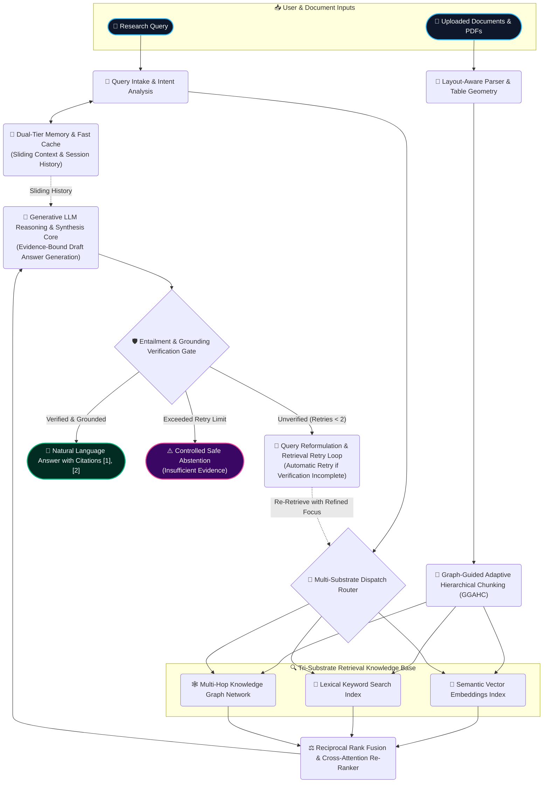

# 🏛️ RAISE: Research Assessment Intelligence & Semantic Extraction

> **Multi-Hop Knowledge Graph & Hybrid Retrieval-Augmented Generation (GraphRAG) Platform**  
> Designed for institutional annual reports, academic literature, and technical documents with source citations and evidence grounding.

---

## 🌟 Why This Pipeline is Necessary & What It Solves

Institutional annual reports, university research audits, patent libraries, and regulatory filings are dense, multi-hundred-page documents packed with hierarchical sections, multi-column layouts, financial schedules, and cross-referenced appendices.

### The Breakdown of Traditional Retrieval & Standard RAG
When applied to complex institutional documents, conventional search engines and naive retrieval-augmented generation systems can face four common limitations:

1. **Semantic Fragmentation**: Fixed-size character chunking can slice through table geometries, footnotes, and headings, separating figures from their textual context.
2. **Multi-Hop Information**: Critical answers often require connecting isolated facts scattered across chapters (e.g., matching a funding grant on page 14 with an equipment expenditure audit on page 182 and an investigator list on page 240). Vector similarity search alone struggles to traverse these multi-step relational paths.
3. **Keyword & Identifier Mismatches**: Dense vector embeddings can sometimes compress or alter specific project identifiers, alphanumeric grant codes, and monetary figures, matching semantic neighbors rather than exact records.
4. **Accuracy Challenges**: Generative models can introduce inaccuracies when supporting context is missing or ambiguous, posing challenges for academic and institutional research.

---

### What the RAISE Pipeline Aims to Solve

RAISE explores a multi-engine architecture designed to address these points of failure:

- **Structural & Table Integrity**: Preserves reading geometry, hierarchy, and tabular data using **Graph-Guided Adaptive Hierarchical Chunking (GGAHC)**, helping keep numbers and their corresponding headers associated.
- **Tri-Substrate Knowledge Synthesis**: Coordinates **dense vectors** (conceptual semantics), **lexical inverted indexes** (exact grant codes and names), and a **knowledge graph** (entity and relationship traversal) to help resolve cross-document dependencies.
- **Continuous Conversational Context**: Couples an **in-memory cache** with **session memory** to maintain multi-turn dialogue context across interactions.
- **Grounding Verification & Retry**: Evaluates generated text against retrieved evidence. When statements lack sufficient supporting context, the system can reformulate search parameters and trigger a targeted re-retrieval pass before abstaining.
- **Page-Level Citation Provenance**: Generated statements are linked to source document names, page coordinates, and paragraph references to support manual verification and transparent auditability.

---

## ⚙️ Core System Architecture & Functional Capabilities



---

### Core Functional Capabilities

| Architecture Stage | Functional Component | Core Logic & Execution |
| :--- | :--- | :--- |
| **1. Ingestion** | **Graph-Guided Chunking (GGAHC)** | Parses complex layouts; uses graph community signals to preserve tables and keep linked concepts unified. |
| **2. Retrieval** | **Tri-Substrate Knowledge Base** | Concurrent search across **Dense Vectors** (semantic match), **Lexical Index** (exact IDs/codes), and **Knowledge Graph** (entity paths). |
| **3. Memory** | **Dual-Tier Context Layer** | Couples **Sub-Millisecond Cache** (fast query reuse) with **Long-Term Session Memory** (multi-turn thread tracking). |
| **4. Fusion** | **RRF & Cross-Attention Re-Ranker** | Combines multi-substrate candidate ranks via Reciprocal Rank Fusion, then re-scores with deep cross-attention. |
| **5. Synthesis** | **Generative LLM Reasoning Core** | Performs multi-hop logical deduction, synthesizing draft responses grounded in retrieved context. |
| **6. Quality Gate** | **Grounding Check & Retry Loop** | Checks claims against retrieved context; can trigger automated query reformulation (up to 2 retries) when evidence is insufficient. |
| **7. Final Outcomes** | **Grounded Answers & Safe Refusal** | Emits natural language answers with page citations (`[1]`, `[2]`), or returns a safe refusal message when sufficient evidence cannot be retrieved. |

---

## 🔀 Repository Branch Architecture

The repository [`semanticClimate/RAISE`](https://github.com/semanticClimate/RAISE) is organized into dedicated branches to decouple user-facing presentation, reasoning engines, and orchestration:

| Branch / Location | Direct Link | Architecture & Scope |
| :--- | :--- | :--- |
| **`main` (Monorepo)** | [🌿 **Open `main` Branch**](https://github.com/semanticClimate/RAISE/tree/main) | • Unified full-stack monorepo containing `frontend/` and `backend/` subdirectories<br/>• System entrypoint, master documentation & architecture |
| **`frontend` (Standalone)** | [🌿 **Open `frontend` Branch**](https://github.com/semanticClimate/RAISE/tree/frontend) | • Standalone React 19 + TypeScript + Vite workstation at root level<br/>• Single-click runners (`START_RAISE_FRONTEND.*`) with auto-download |
| **`backend` (Standalone)** | [🌿 **Open `backend` Branch**](https://github.com/semanticClimate/RAISE/tree/backend) | • Standalone Python FastAPI REST and SSE streaming server at root level<br/>• 15-node cyclical LangGraph state machine & multi-substrate engines |

> 📘 Detailed setup guides, dependency manifests, and component architectures for individual subsystems are maintained directly inside their respective [**`frontend` branch README**](https://github.com/semanticClimate/RAISE/tree/frontend) and [**`backend` branch README**](https://github.com/semanticClimate/RAISE/tree/backend).

---

## 🔗 How Frontend & Backend Connect

The RAISE architecture cleanly decouples the visual interface ([`frontend`](https://github.com/semanticClimate/RAISE/tree/frontend)) from the reasoning and retrieval engine ([`backend`](https://github.com/semanticClimate/RAISE/tree/backend)), allowing them to communicate seamlessly across standard network protocols.

```
┌──────────────────────────────────────┐               ┌──────────────────────────────────────┐
│           Frontend Client            │               │            Backend Engine            │
│   (React 19 + TypeScript + Vite)     │               │      (FastAPI + Python + Rust)       │
│                                      │               │                                      │
│ • Interactive Graph Canvas           │   REST APIs   │ • Document Ingestion & Chunking      │
│ • Real-Time Chat Interface           │ ────────────► │ • Hybrid Tri-Substrate Retrieval     │
│ • Deep PDF Citation Inspector        │ ◄──────────── │ • Property Graph & Vector Stores     │
│ • System Telemetry & Monitor         │               │ • In-Memory Cache & Relational DB    │
│                                      │               │                                      │
│ • Streaming Answer Renderer          │   SSE Stream  │ • Real-Time Token Generation         │
│ • Query Lifecycle Step Tracker       │ ◄════════════ │ • Step-by-Step Execution Traces      │
└──────────────────────────────────────┘               └──────────────────────────────────────┘
```

### 1. Communication Protocols
- **REST Endpoints (`/api/v1/...`)**:
  - `POST /api/documents/upload`: Multi-part PDF upload for layout parsing, chunking, and indexing.
  - `GET /api/documents`: Returns indexed research documents and extraction statuses.
  - `GET /api/graph/subgraph`: Fetches interactive 2D entity-relationship subgraphs for dynamic exploration.
  - `GET /api/health`: Health check reporting database substrates and engine connectivity.
  - `GET /api/sessions`: Manages persistent user conversation histories and thread context.

- **Server-Sent Events (SSE) (`/api/chat/stream`)**:
  - Emits real-time tokens directly to the interface as reasoning progresses.
  - Streams detailed lifecycle steps: `planning` → `retrieving` → `fusing` → `synthesizing` → `verifying`.
  - Transmits structured citation metadata (`[1] Document.pdf, Page 42`) alongside verified claims.

---

### 2. Unified Full-Stack Operation

The complete platform operates in a **Unified Single-Port Mode**:

1. The frontend web assets are pre-built and packaged into the distribution bundle.
2. The backend server mounts both the API routers and the static web assets under a single unified port (`8000`).
3. Launching the full-stack server exposes the complete research platform at a single address:
   ```
   http://localhost:8000
   ```
4. Accessing this address loads the entire visual research interface with internal API requests automatically resolved, eliminating cross-origin (CORS) complexity.

---

## 🔬 Retrieval & Reasoning Pipeline Flow

When an institutional researcher submits a query, RAISE executes a structured multi-stage workflow:

1. **Intake & Intent Decomposition**: Evaluates query complexity and determines whether single-hop lexical search or multi-hop graph traversal is required.
2. **Scatter-Gather Parallel Retrieval**: Simultaneously queries:
   - Dense vector collections for contextual semantic relevance.
   - Lexical inverted indexes for exact numerical codes and nomenclature.
   - Property graph edges for interconnected institutional entities.
3. **Reciprocal Rank Fusion**: Normalizes scores across all retrieval modes to generate a balanced candidate set.
4. **Cross-Attention Re-Ranking**: Ranks candidate passages with deep cross-encoder scoring, prioritizing high-density tabular and structural evidence.
5. **Generative Synthesis**: Formulates a reasoned response grounded in the retrieved context and citation sources.
6. **Entailment Quality Gate**: Evaluates generated text against retrieved evidence to verify consistency before final output.
7. **Provenance Attribution**: Returns the final answer with clickable, verifiable citations linked to exact document pages.

---

## 🛡️ Security & Privacy Guardrails

- **Local & Private Deployment**: Compatible with local inference engines and on-premise database instances so institutional documents remain within your local infrastructure.
- **Query Validation & Sanitization**: Validates graph queries against syntax trees to guard against malformed or unauthorized database operations.
- **Reverse Proxy Compatibility**: Supports outbound tunnels and standard reverse proxies for controlled web access without opening unnecessary external ports.

---

## 📜 License

This project is licensed under the **Apache 2.0 License**. See the [LICENSE](LICENSE) file for complete details.
