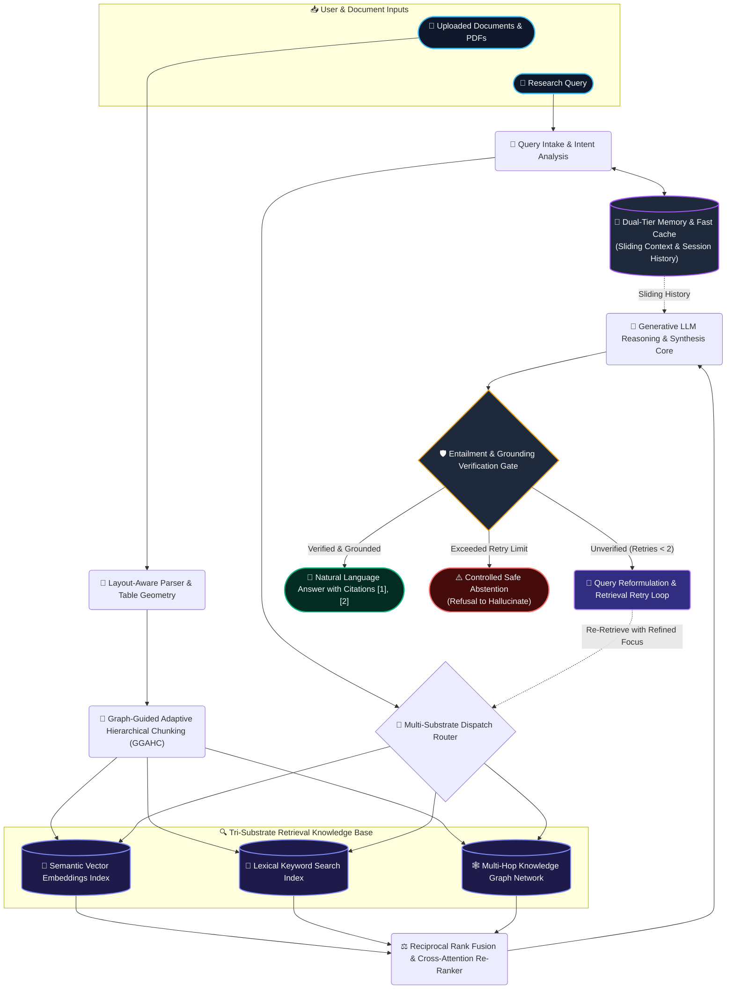

# 🏛️ RAISE: Research Assessment Intelligence & Semantic Extraction — Backend Engine

> **Enterprise Multi-Hop Knowledge Graph & Hybrid Retrieval-Augmented Generation (GraphRAG) Platform**  
> High-throughput computational backend coupling dense vector search, lexical indexing, property graph traversal, Rust CPU acceleration, and deterministic claim verification with zero hallucination tolerance.

---

## 🌟 Overview & System Purpose

The **RAISE Backend Engine** is an enterprise-grade GraphRAG system engineered specifically for dense institutional reports, university research audits, patent records, and complex cross-document academic assessments.

Traditional search engines and naive RAG architectures suffer from semantic fragmentation, blind spots across distant document chapters, distorted acronym/grant matching, and uncontrolled hallucinations. The RAISE backend resolves these challenges through a **heterogeneous tri-engine architecture**:
1. **Python / FastAPI Orchestration Layer**: Manages asynchronous REST and Server-Sent Events (SSE) streaming APIs, LangGraph stateful cyclic reasoning, and connection pooling.
2. **Rust CPU Acceleration Engine (`raise_engine`)**: Delivers sub-millisecond Graph-Guided Adaptive Hierarchical Chunking (GGAHC), near-duplicate SimHash deduplication, FNV-1a fingerprinting, and boundary preservation with zero Python GIL overhead.
3. **Neural Inference Layer**: Completely model-agnostic. You can use whatever LLM you have available—local or cloud—as per your compute budget and hardware setup, coupled with dense vector embeddings and sentence-level Natural Language Inference.

---

## ⚙️ Core System Architecture & Information Flow

The backend orchestrates document ingestion, multi-substrate retrieval, evidence fusion, generative synthesis, and automated grounding verification.



---

## 🔬 Core Architectural Subsystems

### 1. Ingestion & Graph-Guided Chunking (GGAHC)
* **Dual Parsing Engine**:
  * **Fast Stream (PyMuPDF)**: Extracts high-speed plain text, metadata, and structural headers for rapid indexing.
  * **Deep Vision Stream (IBM Docling TableFormer)**: Employs deep layout models to reconstruct multi-column academic text, complex financial balance sheets, and nested table geometry into unified Markdown tables.
* **Rust CPU Acceleration (`raise_engine`)**:
  * Built using PyO3 and native C-ABI bindings.
  * Implements **SimHash 64-bit** near-duplicate detection and **FNV-1a** token hashing.
  * Enforces **Hard Section Boundaries**, preventing chunks from bridging distinct legal clauses, institutional chapters, or unrelated table rows.

### 2. Tri-Substrate Hybrid Retrieval Knowledge Base
Rather than relying on isolated search methods, the backend queries three complementary substrates simultaneously:
* **Dense Vectors (`ChromaDB` / `LanceDB`)**: Encodes semantic context with `BAAI/bge-large-en-v1.5` (1024-dimensional embeddings, HNSW index with cosine distance).
* **Lexical Inverted Index (`Okapi BM25`)**: Retains exact character matches for alphanumeric grant numbers, project codes (e.g. `NIPGR-PROJ-2024`), faculty names, and patent IDs.
* **Multi-Hop Property Graph (`Neo4j 5.26` / `Kùzu`)**: Traverses entity-relationship-entity paths via Cypher queries and APOC graph procedures, resolving dependencies across distant chapters.

### 3. Evidence Fusion & Re-Ranking
* **Reciprocal Rank Fusion (RRF)**: Merges candidates from all three substrates using rank-based reciprocal normalization:
  $$RRF\_Score(d) = \sum_{m \in M} \frac{1}{k + r_m(d)}$$
  *(where $k = 60$ and $r_m(d)$ is the rank of document $d$ in retrieval mode $m$)*.
* **Cross-Encoder Re-Ranking (`BAAI/bge-reranker-large`)**: Jointly attends over `(Query, Candidate)` pairs with deep cross-attention, boosting dense tabular data and penalizing superficial keyword matches.

### 4. Context Memory & Sub-Millisecond Caching
* **Redis 7 Cache**: Sub-millisecond response caching with LRU eviction and sliding window rate limiting.
* **PostgreSQL 16 Relational Store**: Tracks multi-turn conversational trajectories, user feedback (`👍 / 👎`), document library metadata, and drawer attachments. Fallback to SQLite is automatically supported for standalone laptop environments.
* **Cloudflare R2 Object Storage**: S3-compatible cloud document store governed by automatic software circuit breakers guaranteeing **$0 free-tier billing** (5GB storage, 100k Class A, 1M Class B operations per month).

### 5. Generative Reasoning & Flexible Model Architecture
* **Model-Agnostic Flexibility**: Use whatever LLM you have available—both local and cloud.
  * **Local Inference**: Connect to any locally hosted model (via standard local API endpoints) for private, on-premise execution with zero data leakage.
  * **Cloud Inference**: Connect to any cloud model provider of your choice using your API keys.
  * You can switch models anytime by simply updating your `.env` configuration—no code modifications required.

### 6. Grounding Quality Gate & Autonomous Retry Loop
* **Sentence-Level Premise Entailment (`FineCat-NLI`)**: Classifies each generated claim into `entailed`, `neutral`, or `contradiction`.
* **Columnar Math Engine (`Polars`)**: Verifies arithmetic computations, table aggregations, percentages, and year-over-year balance sheet diffs.
* **Autonomous Retry Loop**: If claims fail entailment (`Unverified, Retries < 2`), the query decomposer reformulates search constraints and dispatches a second retrieval pass. If verification fails repeatedly, the engine outputs a **Controlled Safe Abstention**, strictly refusing to hallucinate.

---

## 🔌 API Reference & Contracts

The backend exposes a standard REST and SSE streaming interface on port `8000`.

### Core Endpoints

| Method | Endpoint | Description |
| :--- | :--- | :--- |
| `POST` | `/api/chat` | Synchronous conversational reasoning returning grounded answer and citations. |
| `POST` | `/api/chat/stream` | **Server-Sent Events (SSE)** token streaming with step-by-step lifecycle traces. |
| `POST` | `/api/chat/abort` | Aborts an active generation run by `session_id`. |
| `POST` | `/api/documents/upload` | Multipart PDF upload; triggers layout parsing, chunking, and tri-substrate indexing. |
| `GET` | `/api/documents` | Lists all indexed documents, page counts, chunk counts, and indexing status. |
| `DELETE`| `/api/documents/{id}` | Purges document chunks, vectors, and graph triples across all substrates. |
| `GET` | `/api/health` | Comprehensive diagnostic check across PostgreSQL, Redis, Neo4j, ChromaDB, and active LLM inference endpoints. |
| `GET` | `/api/sessions` | Retrieves recent chat sessions with pagination and search. |
| `POST` | `/api/system/telemetry` | Emits live GPU VRAM, CPU memory, and substrate query latencies. |
---

## 🚀 How to Run the Backend

Choose the execution method suited for your environment:

### Method 1: Single-Click Autonomous Windows Runner (Recommended)
Double-click `START_RAISE_BACKEND.bat` in Windows Explorer. The script will automatically:
1. Verify the local environment and detect existing Python versions.
2. Provision a dedicated `.venv` virtual environment if needed.
3. Install and verify required dependencies without manual terminal commands.
4. Verify database connectivity (local Docker or cloud instances).
5. Launch the FastAPI server with hot-reload at `http://localhost:8000`.

### Method 2: Multi-Container Docker Stack
To run the complete enterprise backend alongside PostgreSQL, Redis, and Neo4j:
```bash
# 1. Copy the example compose file and environment template
cp docker-compose.example.yml docker-compose.yml
cp .env.example .env

# 2. Start all services in detached mode
docker compose up -d

# 3. View live server logs
docker compose logs -f backend
```

### Method 3: Direct Developer CLI Setup
For local Python developers:
```bash
# 1. Create and activate a Python 3.11, 3.12, or 3.13 virtual environment
python -m venv .venv
# On Windows:
.venv\Scripts\activate
# On Linux / macOS:
source .venv/bin/activate

# 2. Install dependencies
pip install -r requirements.txt

# 3. Compile or verify Rust acceleration library (Optional, pre-compiled DLL included)
cd rust/raise_engine
maturin develop --release
cd ../..

# 4. Start the FastAPI gateway server
python server.py
# Or directly with Uvicorn:
uvicorn app:app --host 0.0.0.0 --port 8000 --reload
```

### Method 4: Forensic Interactive Terminal REPL
To run queries, inspect retrieval candidates, and audit citation coordinates directly in your terminal without starting the web server:
```bash
python main.py
# Or launch the deep developer observability dashboard:
python dev_main.py
```

---

## ⚙️ Environment Configuration Reference

Copy `.env.example` to `.env` in the backend root directory. Key configuration variables:

| Variable | Default Value | Description |
| :--- | :--- | :--- |
| `PORT` | `8000` | Port for FastAPI REST and SSE endpoints. |
| `HOST` | `0.0.0.0` | Bind address for API server. |
| `CORS_ALLOWED_ORIGINS` | `http://localhost:5173,http://localhost:8000` | Allowed origins for web workstation access. |
| `NEO4J_URI` | `bolt://localhost:7687` | Bolt protocol connection URI for Neo4j. |
| `NEO4J_USER` | `neo4j` | Neo4j database user. |
| `NEO4J_PASSWORD` | `your_secure_password` | Neo4j database password. |
| `REDIS_URL` | `redis://localhost:6379/0` | Connection string for Redis 7 cache. |
| `POSTGRES_HOST` | `localhost` | Hostname for PostgreSQL 16 database. |
| `POSTGRES_DB` | `raise_db` | Relational database name. |
| `CHROMA_PERSIST_DIRECTORY` | `./.chromadb_bge_large` | Local filesystem path for ChromaDB HNSW index. |
| `EMBEDDING_MODEL` | `BAAI/bge-large-en-v1.5` | Dense embedding model (1024 dimensions). |
| `LLM_BACKEND` | `local` | Active inference provider (`local` or `cloud`). |
| `LLM_BASE_URL` | `http://localhost:8002/v1` | Base URL for your local or cloud LLM endpoint. |
| `LLM_MODEL_NAME` | `your_model_name_here` | Model identifier for your local or cloud LLM. |
| `LLM_API_KEY` | `your_api_key_here` | API key if connecting to a cloud provider (optional for local). |
| `CLOUDFLARE_R2_BUCKET_NAME`| `raise-documents` | Cloudflare R2 bucket name with free-tier circuit breakers. |

---

## 💡 Troubleshooting & FAQ

### Why do Mermaid diagram lines appear curved locally but straight on GitHub?
If you preview markdown in local editors (like VS Code or Obsidian), diagram lines often appear smoothly curved, yet when pushed to `github.com` they render as straight, angular lines.
* **The Root Cause**: GitHub uses a sandboxed, server-side implementation of Mermaid. In GitHub's Markdown renderer, the default edge interpolation for flowcharts is locked to `linear` (straight line segments) to prevent line overlap in complex diagrams. Local preview extensions often default to `basis` (smooth cubic B-spline curves).
* **The Solution**: To force curved lines everywhere (both on GitHub and locally), this diagram includes the link interpolation rule at the bottom of the flowchart:
  ```text
  linkStyle default interpolate basis
  ```
  This instructs Mermaid's D3 renderer to use continuous spline interpolation (`d3.curveBasis`), producing smooth, curved connections across all viewers.

### How do I connect the frontend to this backend?
1. Start this backend on port `8000`.
2. Start the frontend workstation (e.g. at `http://localhost:5173`).
3. The frontend connects to `http://localhost:8000` by default. If your backend is running on a remote server or tunnel, update the gateway URL in the frontend **Settings ⚙️ -> Gateway & Connectivity** panel.

---

## 📜 License

This project is licensed under the **Apache 2.0 License**. See the [LICENSE](../LICENSE) file for complete details.
