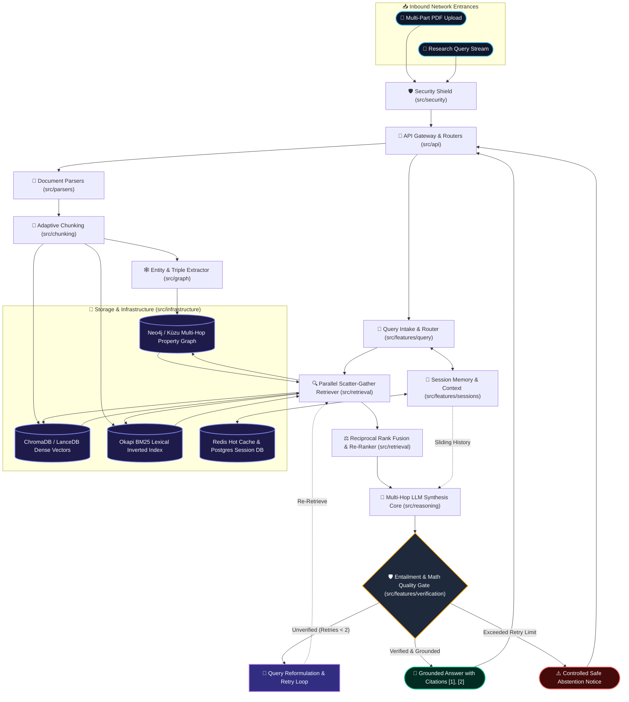

# 🧩 RAISE Source Architecture (`backend/src/`) — Internal Subsystem & Data Flow Guide

> **Authoritative Specification of Internal Modules, Inter-Folder Contracts, and End-to-End Data Movement**  
> This document maps how raw PDF documents and researcher queries flow across each subfolder inside `backend/src/`.

---

## 🗺️ High-Level Internal Data Movement Architecture

The diagram below illustrates how data moves through the subfolders of `src/`, from network entry to persistent storage and verified output generation.



---

## 📂 Subfolder Catalog & Domain Responsibilities

| Subfolder | Primary Domain | Key Responsibilities | Key Dependencies |
| :--- | :--- | :--- | :--- |
| [**`api/`**](api/README.md) | REST & SSE Gateway | Exposes FastAPI endpoints, validates Pydantic v2 schemas, manages active SSE streaming connections, and handles asynchronous cancellation signals. | `core/`, `features/`, `security/` |
| [**`security/`**](security/README.md) | Network & Edge Defense | Pure ASGI shield protecting against malicious payloads, O(1) Redis IP blacklisting, pre-flight port sweep, and two-step ephemeral token handshakes. | `core/`, `infrastructure/cache/` |
| [**`parsers/`**](parsers/README.md) | Layout Document Extraction | Multi-modal PDF ingestion. Couples PyMuPDF for fast plain-text extraction with IBM Docling TableFormer for deep layout, OCR, and table structure reconstruction. | `core/` |
| [**`chunking/`**](chunking/README.md) | Adaptive Semantic Chunking | Implements the 8-stage Graph-Guided Adaptive Hierarchical Chunking (GGAHC) algorithm. Bridges with the Rust `raise_engine` for SimHash deduplication and section boundary protection. | `core/`, `rust/raise_engine` |
| [**`graph/`**](graph/README.md) | Knowledge Graph Semantics | Resolves extracted named entities and relationships into property graph schemas. Manages Cypher query generation for Neo4j and local Kùzu embedded graphs. | `core/`, `infrastructure/graph/` |
| [**`retrieval/`**](retrieval/README.md) | Multi-Substrate Search & Fusion | Orchestrates parallel scatter-gather queries across Vector, Lexical (BM25), and Graph databases. Performs Reciprocal Rank Fusion (RRF) and deep Cross-Encoder re-ranking. | `core/`, `infrastructure/` |
| [**`reasoning/`**](reasoning/README.md) | Multi-Hop LLM Synthesis | Coordinates query planning, temporal and numerical operators, and synthesizes answers strictly bounded by retrieved evidence. | `core/`, `infrastructure/llm/` |
| [**`features/`**](features/README.md) | High-Level Business Logic | Houses specialized engines for Query Intake, Conversational Memory, Polars Math Auditing, FineCat-NLI Claim Verification, and Session State. | `core/`, `infrastructure/`, `retrieval/` |
| [**`infrastructure/`**](infrastructure/README.md) | Hardware, DB & Model Drivers | Concrete database connectors (Neo4j, ChromaDB, PostgreSQL, Redis), Cloudflare R2 object storage with circuit breakers, and unified local and cloud LLM execution. | `core/` |
| [**`core/`**](core/README.md) | Central Types & Invariants | Defines Pydantic-settings environment variables, pipeline invariant contracts, and core data types (`DocumentChunk`, `TelemetryFrame`, `VerificationStatus`). | Standard Library, Pydantic |

---

## 🔄 End-to-End Data Movement Lifecycles

### 1. Document Ingestion Lifecycle
```
[Client PDF Upload] 
   ──> src/security/ (ASGI stream validation)
   ──> src/api/routers/documents.py (Multipart intake)
   ──> src/parsers/ (PyMuPDF fast stream + Docling TableFormer table extraction)
   ──> src/chunking/ (GGAHC hierarchical tree + Rust SimHash deduplication)
   ──> src/graph/ (Named entity resolution & triple extraction)
   ──> src/infrastructure/
         ├── vector/chroma.py (Embed 1024-dim BGE-Large vectors)
         ├── retrieval/bm25.py (Tokenize into inverted index)
         ├── graph/neo4j.py (Create property graph nodes & relationships)
         └── database/postgres.py (Save document metadata & chunk records)
```

### 2. Conversational Query & Grounding Lifecycle
```
[User Chat Query]
   ──> src/security/ (Handshake token check & rate limiter)
   ──> src/api/routers/chat.py (Stream endpoint initialization)
   ──> src/features/query/ (Coreference resolution & intent classification)
   ──> src/infrastructure/cache/ (Check Redis sub-ms cache for hit)
   ──> src/retrieval/parallel_retriever.py (Scatter parallel queries)
         ├── ChromaDB (Semantic dense match)
         ├── Okapi BM25 (Exact project & grant ID match)
         └── Neo4j (2-hop graph relation traversal)
   ──> src/retrieval/fusion.py (Reciprocal Rank Fusion normalization, k=60)
   ──> src/retrieval/reranker.py (BAAI/bge-reranker-large cross-attention)
   ──> src/reasoning/synthesizer.py (Assemble prompt + sliding history)
   ──> src/infrastructure/llm/ (Stream tokens from your configured local or cloud LLM)
   ──> src/features/verification/
         ├── FineCat-NLI (Sentence-level claim entailment)
         └── Polars Math Engine (Verify table math & numbers)
   ──> Outcomes:
         ├── If Grounded ──> Stream SSE citations [1], [2] & verified answer
         ├── If Unverified ──> Refine query & re-retrieve (max 2 passes)
         └── If Exceeded ──> Controlled Safe Abstention notice
```

---

## 🛡️ Inter-Subfolder Architectural Contracts

To maintain modularity and prevent circular dependencies, `src/` enforces the following layering rules:
1. **`core/` is leaf-level**: It imports no other package in `src/`. All subfolders may import `core/`.
2. **`infrastructure/` never imports `api/` or `reasoning/`**: Database and LLM drivers are decoupled from HTTP APIs and reasoning logic.
3. **`features/` depends on `infrastructure/` and `core/`**: Domain services interact with database drivers via explicit repository interfaces.
4. **`api/` is the orchestrator**: Routers consume domain services from `features/` and `retrieval/` via FastAPI dependency injection (`src/api/dependencies.py`).
