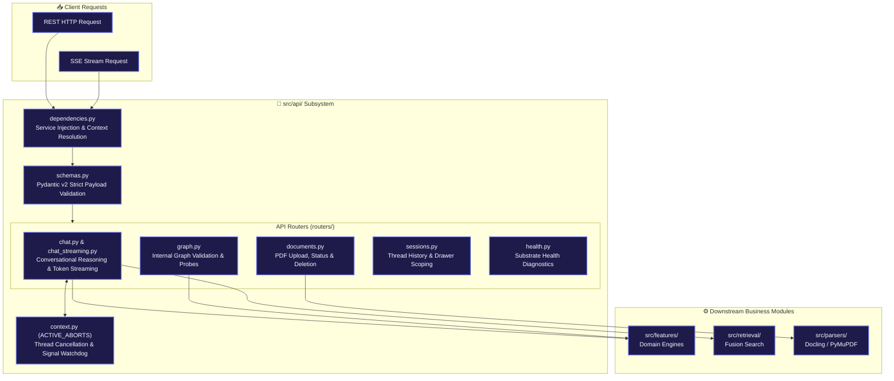

# 🔌 API Subsystem (`backend/src/api/`)

> **FastAPI Gateway, Route Handlers, Schemas & Streaming Controllers**

---

## 🌟 Overview

The `src/api/` package provides the external HTTP REST and Server-Sent Events (SSE) interfaces for the RAISE platform. It acts as the orchestration bridge connecting frontend user actions with internal retrieval, ingestion, and reasoning engines.

---

## 🔄 Data Movement & Request Flow

---

## 📁 Key Components & Module Responsibilities

| File | Primary Responsibility |
| :--- | :--- |
| **`schemas.py`** | Central Pydantic v2 schemas (`ChatRequest`, `ChatResponse`, `DocumentMetadata`, `SystemTelemetryFrame`). Enforces strict typing and JSON schema contracts. |
| **`dependencies.py`** | FastAPI dependency injection hub. Injects database sessions (`PostgresManager`), cache instances (`RedisCacheManager`), and services into route handlers. |
| **`context.py`** | Manages global thread contexts, local IP detection, and `ACTIVE_ABORTS` dictionary for non-blocking stream cancellation. |
| **`routers/chat.py`** | Orchestrates synchronous and streaming conversational GraphRAG queries. |
| **`routers/chat_streaming.py`** | Implements the Server-Sent Events (SSE) generator, emitting real-time tokens and lifecycle traces (`planning` → `retrieving` → `fusing` → `synthesizing` → `verifying`). |
| **`routers/documents.py`** | Multi-part upload handler, PDF status tracker, and document drawer management. |
| **`routers/graph.py`** | Internal graph validation and read-only Cypher query execution for diagnostics. |
| **`routers/health.py`** | Subsystem liveness and readiness diagnostic checks (Neo4j, Redis, PostgreSQL, ChromaDB, LLM backend). |
| **`routers/sessions.py`** | Conversation lifecycle manager, session persistence, and message history retrieval. |
