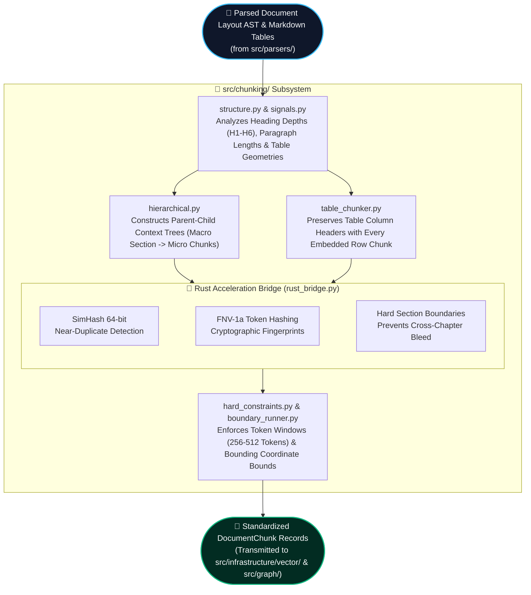

# 🧩 Chunking Subsystem (`backend/src/chunking/`)

> **Graph-Guided Adaptive Hierarchical Chunking (GGAHC) & Rust CPU Acceleration Engine**

---

## 🌟 Overview

The `src/chunking/` package transforms layout-parsed PDF structures and Markdown tables into dense, semantic, verifiable text chunks. It coordinates with the native Rust `raise_engine` to execute high-speed SimHash deduplication, section boundary preservation, and hierarchical parent-child linking.

---

## 🔄 Data Movement & Transformation Flow

---

## 📁 Key Components & Module Responsibilities

| File | Primary Responsibility |
| :--- | :--- |
| **`hierarchical.py`** | Builds multi-tier chunk hierarchies. Parent chunks retain high-level section context, while micro child chunks are used for pinpoint vector retrieval. |
| **`table_chunker.py`** | Specialized table parser. Re-attaches table headers to every individual chunk row, preventing floating numbers without labels. |
| **`rust_bridge.py`** | High-speed C-ABI / PyO3 interface to `raise_engine.dll` / `raise_engine.so`. Executes CPU-intensive hashing and string normalization with zero Python GIL contention. |
| **`hard_constraints.py`** | Enforces hard limits: maximum token lengths, minimum chunk sizes, and geometric paragraph containment. |
| **`boundary_runner.py`** | Ensures chunks strictly terminate at physical document boundaries (chapter ends, legal signature blocks, appendices). |
| **`signals.py`** | Emits adaptive semantic split signals based on punctuation density, lexical shifts, and table geometry transitions. |
