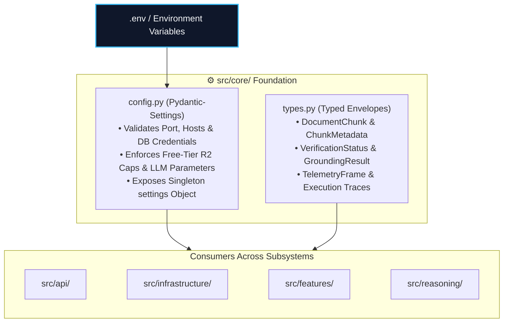

# ⚙️ Core Subsystem (`backend/src/core/`)

> **Typed Configuration, Invariant Envelopes & Foundation Contracts**

---

## 🌟 Overview

The `src/core/` package defines the foundational data types, pipeline invariants, and runtime configuration settings for the entire backend application. It is the leaf dependency of the backend architecture: all other subfolders may import `src/core/`, but `src/core/` imports nothing else within `src/`.

---

## 🔄 Configuration Loading & Typing Architecture

---

## 📁 Key Components & Module Responsibilities

| File | Primary Responsibility |
| :--- | :--- |
| **`config.py`** | Type-safe configuration management using `pydantic-settings`. Loads `.env` values, validates connection strings, and provides immutable runtime constants across the entire engine. |
| **`types.py`** | Defines canonical data envelopes (`DocumentChunk`, `GroundingVerdict`, `TelemetryFrame`, `SessionContext`) used across ingestion, retrieval, synthesis, and verification. |
