# 🛡️ Features Subsystem (`backend/src/features/`)

> **Domain Services: Query Intake, Verification Gate, Session State, Memory & System Telemetry**

---

## 🌟 Overview

The `src/features/` package contains the high-level business logic and specialized domain engines for the RAISE platform. It isolates query parsing, conversational memory, mathematical auditing, and sentence-level Natural Language Inference (NLI) claim verification.

---

## 🔄 Feature Interaction & Verification Data Flow

```mermaid
flowchart TD
    %% Features Hub
    subgraph FeaturesHub ["🛡️ src/features/ Domain Modules"]
        direction TB

        subgraph IngestionFeatures ["Ingestion & Session Management"]
            direction LR
            F_Sessions["sessions/<br/>Thread Lifecycle & History"]
            F_Ingest["ingestion/<br/>Batch Ingestion & Sync"]
            F_Memory["memory/<br/>Dual-Tier Sliding Context"]
            F_Sessions ~~~ F_Ingest ~~~ F_Memory
        end

        subgraph QueryFeatures ["Query Intake & Processing"]
            direction LR
            F_Intake["query/intake.py<br/>Sanitization & Validation"]
            F_Coreference["query/coreference.py<br/>Pronoun & Prior Turn Resolution"]
            F_Router["query/intent_router.py<br/>Fast Direct vs Expert Mode"]
            F_Intake ~~~ F_Coreference ~~~ F_Router
        end

        subgraph VerificationFeatures ["Grounding Verification & Quality Gate"]
            direction TB
            ClaimVerifier["verification/claim_verifier.py<br/>Splits Draft Answer into Atomic Sentences"]
            
            subgraph DualAuditors ["Parallel Entailment & Math Auditors"]
                direction LR
                NLIEngine["evaluation/nli_verifier.py<br/>FineCat-NLI Premise Classification<br/>(Entailed / Contradicted)"]
                MathEngine["verification/polars_engine.py<br/>Columnar Math Engine<br/>(Verifies Arithmetic Against Tables)"]
                NLIEngine ~~~ MathEngine
            end

            QualityGate["evaluation/quality_gate.py<br/>Evaluation Decision Engine"]
        end

        subgraph SystemFeatures ["System Telemetry & Health"]
            direction LR
            F_Telem["system/telemetry_service.py<br/>GPU VRAM, Latency & IO Monitor"]
            F_Health["system/health_checks.py<br/>Multi-Database Liveness Probes"]
            F_Telem ~~~ F_Health
        end
    end

    %% Routing
    F_Intake --> F_Coreference
    F_Coreference --> F_Router
    F_Memory <--> F_Sessions

    ClaimVerifier --> DualAuditors
    DualAuditors --> QualityGate

    classDef node fill:#1e1b4b,stroke:#818cf8,stroke-width:2px,color:#f8fafc;
    linkStyle default interpolate basis
```

---

## 📁 Key Subpackages & Domain Responsibilities

| Subpackage | Primary Responsibility |
| :--- | :--- |
| [**`verification/`**](verification/README.md) | **Deterministic Fact & Math Verification**: Splits draft answers into individual assertions. `polars_engine.py` and `math_engine.py` re-calculate totals, growth rates, and percentages against source tables to catch arithmetic hallucinations. |
| [**`evaluation/`**](evaluation/README.md) | **Neural Quality Gate**: Implements FineCat-NLI to classify sentence entailment against source chunks. Coordinates the autonomous retry loop or emits safe abstention notices. |
| [**`query/`**](query/README.md) | **Query Intake & Routing**: Deconstructs queries, resolves coreferences using session history, and routes to appropriate retrieval substrates. |
| [**`memory/`**](memory/README.md) | **Dual-Tier Memory**: Caches recent turns and maintains the sliding context window for multi-turn conversational GraphRAG. |
| [**`sessions/`**](sessions/README.md) | **Session Persistence**: Manages user session threads, conversation histories, and document drawer scoping in PostgreSQL. |
| [**`system/`**](system/README.md) | **Observability & Diagnostics**: Collects GPU VRAM, CPU utilization, database query latencies, and provides system health endpoints. |
| [**`ingestion/`**](ingestion/README.md) | **Batch Ingestion Pipeline**: Coordinates end-to-end ingestion runs across large collections of institutional PDFs. |
