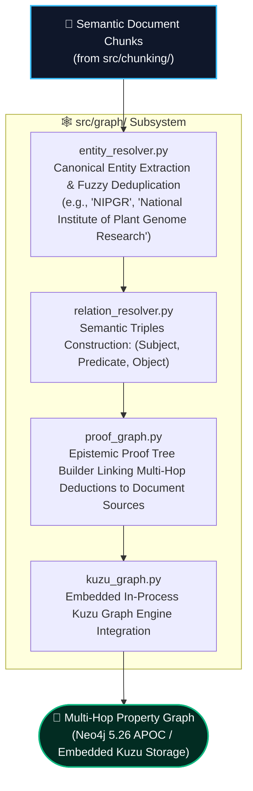

# 🕸️ Graph Subsystem (`backend/src/graph/`)

> **Entity Resolution, Knowledge Graph Construction & Epistemic Proof Trees**

---

## 🌟 Overview

The `src/graph/` package transforms extracted document chunks into semantic entities, relationships, and epistemic proof trees. It reconciles ambiguous institutional entity names and maintains property graph schemas across Neo4j and embedded Kùzu engines.

---

## 🔄 Graph Construction & Resolution Flow

---

## 📁 Key Components & Module Responsibilities

| File | Primary Responsibility |
| :--- | :--- |
| **`entity_resolver.py`** | Extracts named institutional entities (faculty names, grant codes, labs, departments, patents) and merges synonyms into canonical entity records. |
| **`relation_resolver.py`** | Identifies semantic relationships between entities (e.g. `(Professor)-[:FUNDED_BY]->(Grant)`, `(Department)-[:PUBLISHED]->(Report)`). |
| **`proof_graph.py`** | Builds directed acyclic graphs (DAGs) representing multi-hop reasoning proofs, providing visual verification chains from answer back to primary source chunks. |
| **`kuzu_graph.py`** | In-process embedded graph database driver using Kùzu, allowing fast local graph traversal without running a standalone Neo4j instance. |
