# 💾 Infrastructure Subsystem (`backend/src/infrastructure/`)

> **Database Connectors, Vector Stores, Graph Drivers, Cache Managers & Inference Providers**

---

## 🌟 Overview

The `src/infrastructure/` package provides concrete implementations for all external hardware, database, caching, and model providers. It isolates third-party libraries (Neo4j, ChromaDB, PostgreSQL, Redis, LLM drivers) behind clean, typed interfaces.

---

## 🔄 Infrastructure Grid & Connection Architecture

```mermaid
flowchart TD
    %% Internal Callers
    Callers["⚙️ Internal Engines<br/>(Retrieval, Ingestion, Sessions & Synthesis)"]:::inNode

    %% Infrastructure Subsystem
    subgraph InfrastructureHub ["💾 src/infrastructure/ Connectors & Drivers"]
        direction TB

        subgraph VectorSubsystem ["Vector Storage (vector/)"]
            direction LR
            ChromaStore["chroma.py<br/>ChromaDB HNSW (Cosine Space)"]
            LanceStore["lancedb_store.py<br/>LanceDB Local Parquet Vectors"]
            ChromaStore ~~~ LanceStore
        end

        subgraph GraphSubsystem ["Property Graph (graph/)"]
            direction TB
            Neo4jDriver["neo4j.py<br/>Neo4j 5.26 Bolt Connection Pool & APOC Executor"]
            GraphSchema["schema.py<br/>Node Labels, Relationship Types & Indexes"]
        end

        subgraph RelationalCache ["Relational & Cache"]
            direction LR
            PostgresMgr["database/postgres.py<br/>PostgreSQL 16 & SQLite Fallback"]
            RedisMgr["cache/redis.py<br/>Redis 7 Sub-ms Caching & TTL"]
            PostgresMgr ~~~ RedisMgr
        end

        subgraph CloudInference ["Storage & AI Inference"]
            direction LR
            R2Store["storage/r2.py<br/>Cloudflare R2 with $0 Free-Tier Circuit Breakers"]
            LLMRouter["llm/litellm_router.py<br/>Universal Multi-Provider LLM Router"]
            R2Store ~~~ LLMRouter
        end
    end

    Callers --> VectorSubsystem
    Callers --> GraphSubsystem
    Callers --> RelationalCache
    Callers --> CloudInference

    classDef inNode fill:#0f172a,stroke:#38bdf8,stroke-width:2px,color:#f8fafc;
    linkStyle default interpolate basis
```

---

## 📁 Key Packages & Driver Responsibilities

| Package | Primary Responsibility |
| :--- | :--- |
| **`vector/`** | Manages dense vector embeddings (`BAAI/bge-large-en-v1.5`, 1024 dimensions). Provides `chroma.py` for persistent HNSW indexing and `lancedb_store.py` for disk-based vector persistence. |
| **`graph/`** | Manages Neo4j Bolt connections, Cypher queries, relationship edge construction, and transactional session management. |
| **`database/`** | PostgreSQL 16 connection pooling via SQLAlchemy and SQLModel. Automatically falls back to local SQLite on standalone developer laptops when Postgres is unavailable. |
| **`cache/`** | Redis 7 cache manager providing sub-millisecond retrieval caching, sliding window token bucket rate limiting, and ephemeral handshake key storage. |
| **`storage/`** | Cloudflare R2 client enforcing **$0 billing circuit breakers** (caps monthly operations at 5GB storage, 100k Class A, 1M Class B requests). |
| **`llm/` & `providers/`** | Unified interface for local and cloud LLM execution (supports any local or cloud LLM of your choice). |
| **`logging/`** | High-performance structured JSON logging for auditability and runtime observability. |
