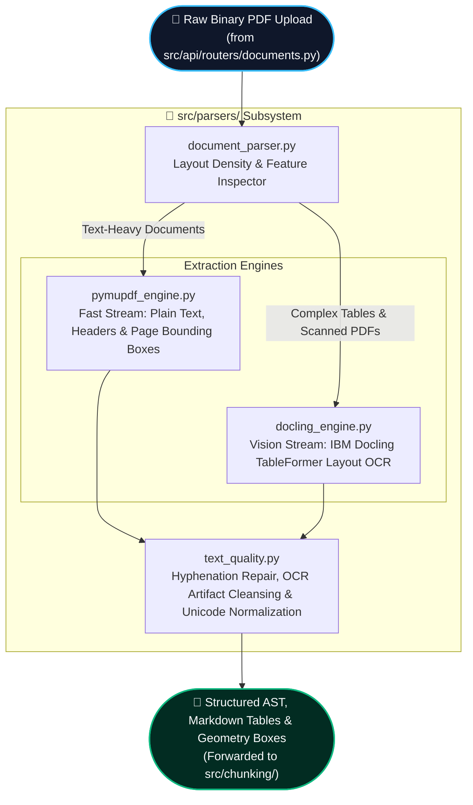

# 📑 Document Parsers Subsystem (`backend/src/parsers/`)

> **Multi-Modal Document Parsing, Table Geometry Recovery & Optical Layout Understanding**

---

## 🌟 Overview

The `src/parsers/` package provides the layout-aware document ingestion engines for the RAISE platform. It bridges unstructured binary PDF files and structured Markdown/AST hierarchies, ensuring complex multi-column reports, financial statements, and academic research papers are faithfully digitized.

---

## 🔄 Parsing Pipeline & Data Movement

---

## 📁 Key Components & Module Responsibilities

| File | Primary Responsibility |
| :--- | :--- |
| **`document_parser.py`** | Master ingestion facade. Inspects incoming PDF characteristics and routes files to either the fast text engine or deep layout model. |
| **`pymupdf_engine.py`** | High-throughput PyMuPDF (fitz) parser. Extracts textual blocks, font weight metrics, heading tags (H1-H4), and exact page-level coordinate bounding boxes. |
| **`docling_engine.py`** | Deep vision parser powered by IBM Docling and TableFormer. Reconstructs multi-cell financial tables, headers, and footnotes into Markdown format. |
| **`text_quality.py`** | Forensic text sanitization. Removes line-break hyphenations, repairs corrupted ligatures, and filters control characters. |
