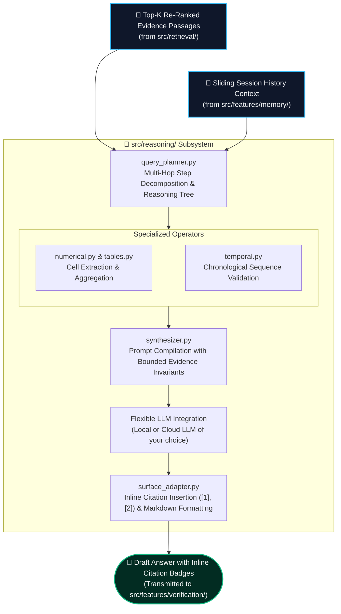

# 🤖 Reasoning Subsystem (`backend/src/reasoning/`)

> **Multi-Hop Query Planning, Table Logic, Temporal Reasoning & Evidence-Bound Synthesis**

---

## 🌟 Overview

The `src/reasoning/` package handles the generation of answers strictly bound to retrieved evidence. It structures multi-hop logical paths, executes table calculations, aligns chronological events, and delegates token generation to your configured local or cloud LLM.

---

## 🔄 Reasoning & Synthesis Data Movement

---

## 📁 Key Components & Module Responsibilities

| File | Primary Responsibility |
| :--- | :--- |
| **`query_planner.py`** | Constructs the execution plan for complex queries. Determines whether an inquiry requires single-step extraction or cross-chapter multi-hop deduction. |
| **`synthesizer.py`** | Compiles prompt contexts, injects evidence passages, enforces refusal rules when evidence is missing, and streams responses token-by-token. |
| **`tables.py` & `numerical.py`** | Interprets tabular structures, extracts cell values, and formats numerical contexts for financial and metric comparisons. |
| **`temporal.py`** | Resolves dates, fiscal years (e.g., FY 2023-24 vs FY 2024-25), and enforces chronological consistency across multi-year institutional reports. |
| **`surface_adapter.py`** | Attaches bracketed citation references (`[1]`, `[2]`) to verified sentences, ensuring each claim is mapped to an identifiable evidence source. |
