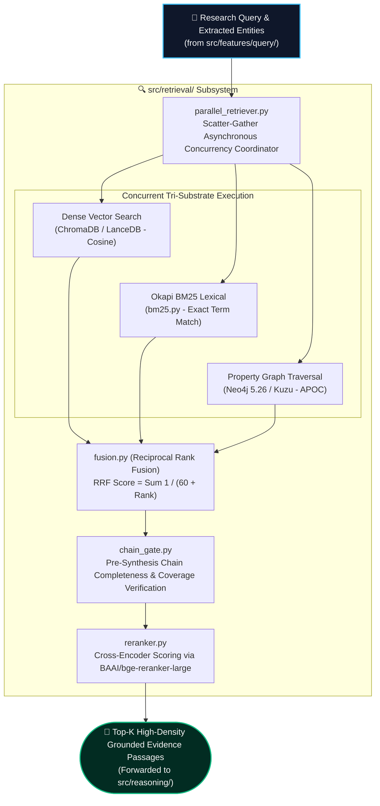

# 🔍 Retrieval Subsystem (`backend/src/retrieval/`)

> **Tri-Substrate Hybrid Retrieval, Reciprocal Rank Fusion (RRF) & Cross-Encoder Re-Ranking**

---

## 🌟 Overview

The `src/retrieval/` package coordinates the search across three heterogeneous knowledge substrates (Dense Vectors, Lexical Inverted Index, and Multi-Hop Property Graph). It normalizes candidate scores using Reciprocal Rank Fusion (RRF) and filters the most relevant evidence passages using deep cross-attention re-ranking.

---

## 🔄 Retrieval & Fusion Data Flow

---

## 📁 Key Components & Module Responsibilities

| File | Primary Responsibility |
| :--- | :--- |
| **`parallel_retriever.py`** | Dispatches concurrent async tasks across Vector, Lexical, and Graph databases, applying drawer-scoping filters and timeout guards. |
| **`bm25.py`** | High-performance in-memory Okapi BM25 index. Preserves exact matches for alphanumeric project IDs, patent codes, and grant identifiers. |
| **`fusion.py`** | Implements Reciprocal Rank Fusion (RRF) to blend heterogeneous rank distributions without needing manual calibration of raw vector vs lexical distance scores. |
| **`reranker.py`** | Cross-attention re-scoring using `BAAI/bge-reranker-large`. Ranks tabular content higher when numerical values in the query match table cells. |
| **`chain_gate.py`** | Validates that multi-hop dependency chains are unbroken before evidence is passed to generative synthesis. |
| **`entity_filtering.py`** | Applies metadata drawer constraints (e.g., scoping search exclusively to selected PDF IDs). |
