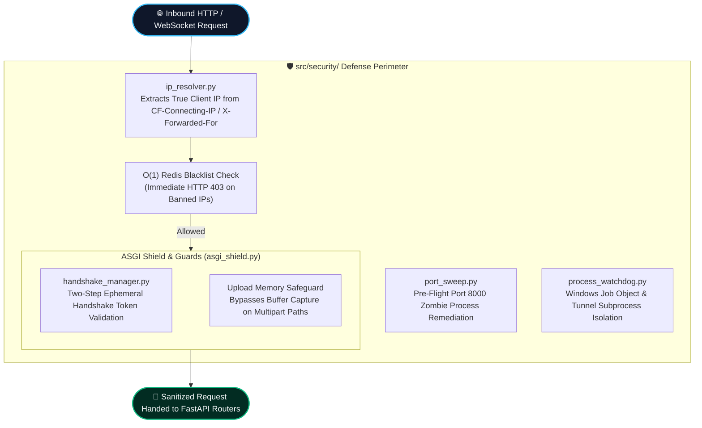

# 🛡️ Security Subsystem (`backend/src/security/`)

> **ASGI Security Shield, Ephemeral Token Handshake, Port Sweep & Edge Defense**

---

## 🌟 Overview

The `src/security/` package implements the zero-trust security perimeter and runtime stability safeguards for the RAISE backend. It isolates incoming HTTP/WebSocket traffic, blocks malicious IP addresses, manages tunnel watchdogs, and prevents memory exhaustion during large document uploads.

---

## 🔄 Security Shield & Request Inspection Flow

---

## 📁 Key Components & Module Responsibilities

| File | Primary Responsibility |
| :--- | :--- |
| **`asgi_shield.py`** | Pure ASGI middleware interceptor. Inspects inbound payloads, enforces origin filters, and protects memory from buffering large multi-megabyte PDF streams. |
| **`handshake_manager.py`** | Two-step WebSocket and SSE handshake manager with atomic key eviction, ensuring only authenticated UI sessions receive token streams. |
| **`ip_resolver.py`** | Safely extracts real client IP addresses across reverse proxies, Cloudflare edge headers, and local development tunnels. |
| **`port_sweep.py`** | Startup diagnostic utility. Automatically terminates lingering zombie processes holding port 8000 on Windows/Linux, preventing `EADDRINUSE` launch crashes. |
| **`process_watchdog.py`** | Isolates background subprocesses (such as Cloudflare named tunnel agents) using Windows Job Objects so that shutting down the server cleanly terminates child processes. |
