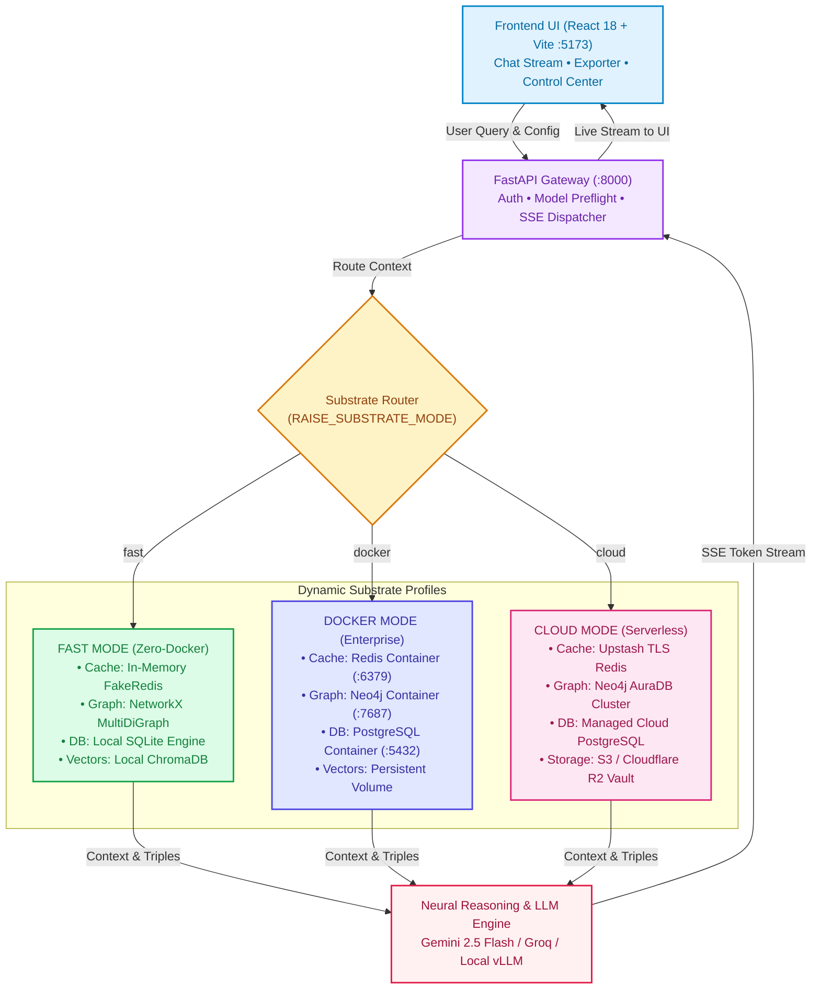
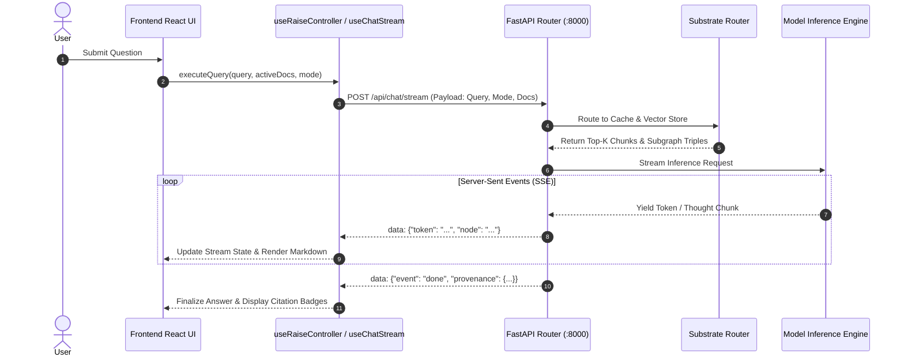

# RAISE System Updates & Architecture Evolution Log

> **Release Version**: RAISE v2.5.0-rc  
> **Last Updated**: 2026-11-17  
> **Scope**: Export Infrastructure, Multi-Mode Substrate Engine (`Fast` / `Docker` / `Cloud`), Dynamic Neural Model Provisioning, Redesigned Control Center, and End-to-End API Architecture.

---

## Table of Contents
1. [User-Facing Export Capabilities](#1-user-facing-export-capabilities)
   - [Individual Response Export](#11-download-individual-response)
   - [Full Conversation Transcript PDF](#12-download-full-conversation-as-pdf)
2. [Chronological Engineering Highlights & Recent Fixes](#2-chronological-engineering-highlights--recent-fixes)
3. [The Three Execution Modes in `START_RAISE.bat`](#3-the-three-execution-modes-in-start_raisebat)
   - [Fast Mode (Local / Zero-Docker)](#31-fast-mode-zero-docker--in-memory)
   - [Docker Mode (Production Enterprise)](#32-docker-mode-full-enterprise-containers)
   - [Cloud Mode (Managed Serverless & Remote)](#33-cloud-mode-managed-cloud--object-storage)
4. [Substrate Architecture & Data Flow Across Modes](#4-substrate-architecture--data-flow-across-modes)
   - [Substrate Transition Matrix](#41-substrate-transition-matrix)
   - [Architecture & Data Flow Diagram (Mermaid)](#42-architecture--data-flow-diagram)
5. [Redesigned Control Center & Hardware Telemetry](#5-redesigned-control-center--hardware-telemetry)
6. [Source-Level Neural Model Download & Frontend Progress Sync](#6-source-level-neural-model-download--frontend-progress-sync)
7. [Full-Stack API Communication & Hook Orchestration](#7-full-stack-api-communication--hook-orchestration)
8. [How to Run the Pipeline (Zero-Friction Quickstart on `re-testing`)](#8-how-to-run-the-pipeline-zero-friction-quickstart-on-re-testing)

---

## 1. User-Facing Export Capabilities

Users can now export audit-grade academic answers and complete research sessions through two purpose-built export pipelines.

### 1.1 Download Individual Response
Users can export a specific AI-generated answer without downloading the entire conversation.
- **Access Point**: Direct response action toolbar located below each assistant answer card (`AssistantActionToolbar.tsx`).
- **Trigger Component**: `ExportResponseDropdown.tsx`.
- **Supported Formats**:
  - **Academic PDF (`.pdf`)**: Formats the selected query, synthetic answer, and scientific evidence tables using pure client-side PDF rendering (`jspdf` / `jspdf-autotable`).
  - **Audited Markdown (`.md`)**: Exports structured markdown complete with frontmatter, document citations, and page-specific coordinates.
  - **Developer JSON (`.json`)**: Exports raw execution traces, including graph retrieval hops, dense vector similarity scores, and claim verification metadata.
  - **Print Direct**: Opens a streamlined, print-styled browser window for immediate hardcopy generation.
- **Header Badge Filtering**: The answer title header displays clean execution presets (`[Fast Mode]` or `[Expert Mode]`), keeping internal HuggingFace checkpoints and model identifiers isolated within the provenance appendix.

### 1.2 Download Full Conversation as PDF
Users can download the complete multi-turn research transcript as an integrated report.
- **Access Point**: The chat history sidebar menu (`ChatSessionItem.tsx` & `SearchSessionItem.tsx`).
- **Trigger Function**: `exportSessionAsPdf(session: ChatSession)`.
- **Capabilities**:
  - Compiles the entire dialog history in chronological order.
  - Retains all user questions, assistant responses, markdown tables, and inline mathematical formulations ($\LaTeX$ rendered via KaTeX).
  - Appends an institutional **System Provenance & Quality Metrics** dossier detailing vector index versions, graph triple counts, and execution hardware.

---

## 2. Chronological Engineering Highlights & Recent Fixes

A summary of foundational improvements preceding this release:

1. **TableFormer & Docling PDF Ingestion Engine**:
   - Upgraded PDF parsing to leverage IBM Docling with TableFormer OCR for complex tabular structures.
   - Successfully resolved multi-column institutional rankings from dense reports (e.g., Page 9 Nature Index table in NIPGR Annual Report 2025).
2. **Substrate Router Fast Mode Fallback**:
   - Added automatic graceful fallback from `fakeredis` to in-memory dictionary caching when running in lightweight environments without compiled C-extensions.

---

## 3. The Three Execution Modes in `START_RAISE.bat`

RAISE provides three distinct execution profiles controlled dynamically via `RAISE_SUBSTRATE_MODE`:

```bat
:: Example launcher configurations
START_RAISE.bat                 :: Defaults to Fast Mode (instant zero-dependency launch)
START_RAISE.bat --docker        :: Launches full containerized production topology
START_RAISE.bat --cloud         :: Connects to managed cloud endpoints & cloud storage
```

### 3.1 Fast Mode (Zero-Docker / In-Memory)
- **Primary Goal**: Instant local startup, zero container prerequisites, and minimal resource footprint. Ideal for laptops, individual researchers, and CI test pipelines.
- **Runtime Substrates**:
  - **Semantic Cache**: In-process `FakeStrictRedis` (with dictionary fallback).
  - **Knowledge Graph**: In-memory `networkx.MultiDiGraph` loaded directly from ingested JSON-L graph triples.
  - **Relational Metadata**: Local SQLite file (`backend/data/raise_local.db`).
  - **Vector Database**: Local ChromaDB instance with persistence at `backend/.chromadb_embeddinggemma_2/`.
- **Startup Time**: ~1–3 seconds (excluding neural model pre-warming).

### 3.2 Docker Mode (Full Enterprise Containers)
- **Primary Goal**: Multi-user concurrency, high-throughput horizontal scaling, and enterprise graph analytics.
- **Runtime Substrates**:
  - **Semantic Cache**: Production Redis container on `redis://localhost:6379/0`.
  - **Knowledge Graph**: Production Neo4j container on `bolt://localhost:7687` with full APOC graph algorithms and persistent disk storage.
  - **Relational Metadata**: Production PostgreSQL container on `postgresql://localhost:5432/raise_prod`.
  - **Vector Database**: Local ChromaDB or Chroma Docker container.
- **Startup Time**: ~15–30 seconds (verifies container health checks before launching web services).

### 3.3 Cloud Mode (Managed Cloud & Object Storage)
- **Primary Goal**: Serverless multi-tenant deployments, centralized enterprise knowledge graphs, and decentralized cloud object storage.
- **Runtime Substrates**:
  - **Semantic Cache**: Upstash Redis or AWS ElastiCache via secure TLS (`rediss://...`).
  - **Knowledge Graph**: Neo4j AuraDB enterprise cluster (`neo4j+s://aura.databases.neo4j.io`).
  - **Relational Metadata**: Managed Cloud PostgreSQL (Supabase / AWS RDS).
  - **Document & Vector Storage**: Amazon S3 / Cloudflare R2 bucket (`s3://raise-academic-vault`) paired with cloud vector services.
- **LLM Priority**: Direct cloud endpoints (Google Gemini 2.5 Flash, Groq LPUs, OpenAI) through secure API keys.

---

## 4. Substrate Architecture & Data Flow Across Modes

### 4.1 Substrate Transition Matrix

| Subsystem | Fast Mode | Docker Mode | Cloud Mode |
|---|---|---|---|
| **Semantic Cache** | `FakeStrictRedis` (In-Memory) | Redis Container (`:6379`) | Upstash / Managed Redis TLS |
| **Knowledge Graph** | `networkx.MultiDiGraph` | Neo4j APOC (`:7687`) | Neo4j AuraDB Cloud |
| **Relational DB** | SQLite (`raise_local.db`) | PostgreSQL Container (`:5432`) | Cloud PostgreSQL (AWS RDS / Supabase) |
| **Dense Vectors** | ChromaDB (`.chromadb_...`) | ChromaDB / Docker Volume | Cloud Pinecone / Chroma Cloud |
| **Document Vault** | Local Filesystem (`data/documents`) | Persistent Docker Volume Mount | Amazon S3 / Cloudflare R2 Storage |
| **LLM Inference** | Cloud API or Local Ollama/vLLM | Containerized vLLM / Local GPU | Managed Cloud APIs (Gemini, Groq) |

### 4.2 Architecture & Data Flow Diagram



---

## 5. Redesigned Control Center & Hardware Telemetry

The Control Center Modal (`frontend/src/features/control-center/`) has been completely overhauled into a multi-stage operational console:

```
┌─────────────────────────────────────────────────────────────────────────────┐
│                          RAISE CONTROL CENTER                               │
├─────────────────────────────────────────────────────────────────────────────┤
│  [Overview]    [Platform]    [Database]    [Neural Models]    [API Keys]    │
├─────────────────────────────────────────────────────────────────────────────┤
│  HARDWARE TELEMETRY                                                         │
│  ● Platform: Windows (win32)       ● CPU: 16 Cores (AMD Ryzen 9 5900X)      │
│  ● RAM: 64.0 GB (48.2 GB Available)● GPU: NVIDIA GeForce RTX 3090 (24 GB)   │
│                                                                             │
│  SUBSTRATE ROUTER STATUS                                                    │
│  ● Active Mode: [FAST MODE] Zero-Docker Local Engine                        │
│  ● Cache: [FAKEREDIS] In-process FakeStrictRedis                            │
│  ● Graph: [FAST-MEM]  In-memory NetworkX MultiDiGraph (342 entities)        │
│  ● Store: [SQLITE]    backend/data/raise_local.db                           │
└─────────────────────────────────────────────────────────────────────────────┘
```

### Key Capabilities
1. **Real-Time Telemetry Polling**:
   - Communicates with `GET /api/hardware/telemetry` to capture live CPU utilization, system RAM pressure, and GPU VRAM consumption.
   - Detects CUDA / Metal acceleration capabilities and adjusts batch sizes dynamically.
2. **Substrate Probing & Diagnostics**:
   - `POST /api/system/test-connections` tests TCP availability, credentials, and ping latency across Neo4j, Redis, and PostgreSQL before switching modes.
3. **Provider Priority Switcher**:
   - Allows seamless switching between **Cloud-First** (Google Gemini, Groq, OpenAI) and **Local-First** (Ollama on port 11434, vLLM on port 8000).

---

## 6. Source-Level Neural Model Download & Frontend Progress Sync

To allow non-technical users to clone the repository and start querying immediately without manual shell commands, RAISE features an integrated neural model auto-provisioning system.

### 6.1 Automated Asset Checklist
During initialization or through the Control Center, RAISE verifies five core asset tiers:
1. `docling_pymupdf`: PDF layout parser and TableFormer OCR models.
2. `google/embeddinggemma-2`: 768-dimensional dense retrieval embedding model.
3. `BAAI/bge-reranker-v2-m3`: 8,192-token context cross-encoder reranker.
4. `dleemiller/finecat-nli-ultra-l`: ModernBERT NLI claim verification classifier.
5. `urchade/gliner_medium-v2.1`: Zero-shot named entity recognition engine.

### 6.2 Preflight Endpoints & Background Provisioning
- **Check Status**: `GET /api/system/preflight-assets`
  Returns verified flags, file paths, and disk footprints for every asset:
  ```json
  {
    "total_footprint": "2.14 GB Total Footprint",
    "total_footprint_gb": 2.14,
    "all_assets_verified": true,
    "assets": [
      {
        "id": "dense_embedding",
        "name": "google/embeddinggemma-2",
        "verified": true,
        "status": "Cached & Verified"
      }
    ]
  }
  ```
- **Trigger Background Download**: `POST /api/system/preflight-download`
  Spawns asynchronous background download tasks via Hugging Face Hub using the verified `HF_TOKEN`.

### 6.3 Real-Time SSE Download Progress Stream
- **Endpoint**: `GET /api/system/models/pull?model_name={repo_id}&provider=huggingface`
- **Frontend Sync**: The `NeuralStep.tsx` component connects to the Server-Sent Events (SSE) stream, updating a reactive progress bar from 0% to 100%:
  ```
  data: {"percent": 45, "status": "Downloading weights for google/embeddinggemma-2 (45%)..."}
  data: {"percent": 100, "status": "Model google/embeddinggemma-2 cached successfully."}
  data: [DONE]
  ```

---

## 7. Full-Stack API Communication & Hook Orchestration

The backend (FastAPI) and frontend (React 18) communicate via a dual-layer protocol: REST for transactional state, and SSE for streaming execution.



### 7.1 Primary API Endpoints

| Method | Endpoint | Description |
|---|---|---|
| `POST` | `/api/chat/stream` | Multi-hop GraphRAG query execution yielding real-time SSE tokens. |
| `GET` | `/api/system/provenance` | Returns active runtime configuration, model IDs, and substrate status. |
| `GET` | `/api/hardware/telemetry` | Provides CPU, RAM, and GPU VRAM diagnostic metrics. |
| `GET` | `/api/system/preflight-assets` | Reports cache and verification state of all required neural checkpoints. |
| `POST` | `/api/system/preflight-download` | Asynchronously pulls missing neural models in background threads. |
| `GET` | `/api/system/models/pull` | Live SSE stream transmitting model download percentages. |
| `POST` | `/api/system/test-connections` | Evaluates connectivity and latency across Cache, DB, and Graph endpoints. |

### 7.2 Frontend React Hook Architecture

The client application orchestrates complex RAG interactions using modular custom hooks located in `frontend/src/features/raise/hooks/`:

- **`useRaiseController`**: The master state orchestrator connecting sessions, sources, speech, and dialog drawers.
- **`useChatStream`**: Manages active SSE connections, token buffers, query abort controllers, and error recovery.
- **`useChatSessions`**: Handles multi-session persistence, session switching, and conversation branching.
- **`useSmartAutoScroll`**: Implements smart scroll locking; binds non-blocking mouse wheel and container scroll listeners to prevent view snapping while reading earlier answers.
- **`useSessionSources`**: Tracks attached document libraries, active PDF filters, and document selection states.

---

## 8. How to Run the Pipeline (Zero-Friction Quickstart on `re-testing`)

RAISE is designed to run out-of-the-box on a fresh clone with zero manual Python environment configuration or complex Docker orchestration.

### Step 1: Clone or Download the Monorepo
Clone the `re-testing` integration branch directly:
```bash
git clone -b re-testing https://github.com/semanticClimate/RAISE.git
cd RAISE
```
*(Alternatively, download the repository as a ZIP archive from GitHub and extract it to any local directory).*

### Step 2: One-Click Startup (`START_RAISE.bat`)
Simply **double-click** the `START_RAISE.bat` file in the root folder, or run it from your terminal:
```bat
START_RAISE.bat
```
The automated supervisor (`connector/helper.ps1`) will:
1. Detect or auto-provision a compatible Python 3.10–3.13 runtime.
2. Verify all core dependencies (FastAPI, Uvicorn, Sentence-Transformers, Transformers, GLiNER, NetworkX, FakeRedis).
3. Check and compile native Rust acceleration modules (`raise_engine`).
4. Ensure the React/Vite frontend dependencies are installed and ready.

### Step 3: Interactive Credential Handshake (Console Prompts)
During the initial boot sequence, the launcher presents two quick prompts in the terminal:

1. **LLM Inference Credential (Gemini / Groq / OpenAI)**:
   ```
   Paste LLM API Key [or press Enter to skip / use local model]: <YOUR_API_KEY>
   ```
   - Supports Google Gemini (recommended default `gemini-2.5-flash`), Groq LPUs, OpenAI, Anthropic, or local inference.
   - The key is validated in real-time and securely saved to your local `.env`.

2. **Hugging Face Token (`HF_TOKEN`)**:
   ```
   Paste Hugging Face Token [or press Enter to skip]: <YOUR_HF_TOKEN>
   ```
   - Used to authenticate and automatically pull the required neural weights directly from Hugging Face Hub (`google/embeddinggemma-2`, `BAAI/bge-reranker-v2-m3`, `dleemiller/finecat-nli-ultra-l`, `urchade/gliner_medium-v2.1`).
   - If skipped, the pipeline automatically runs with cached or local models.

### Step 4: Automatic Pipeline Launch & Browser Startup
Once credentials are confirmed:
- The backend FastAPI server starts on **`http://localhost:8000`**.
- The frontend Vite development server boots on **`http://localhost:5173`**.
- The supervisor **automatically opens your default web browser** directly to `http://localhost:5173`.

### Step 5: Instant Audited Querying from the Attached PDF
You do **not** need to manually upload or index documents to get started:
- An institutional scientific document (such as `NIPGR_BRIC_Annual_Report_2025.pdf`) is **already pre-scanned, parsed with TableFormer OCR, chunked, and embedded into the local ChromaDB vector store and NetworkX knowledge graph**.
- When the chat UI loads, the pre-indexed PDF chip is **already attached and active** in the query workspace.
- You can immediately ask complex, data-dense questions directly in the query box:
  - *"What are the Nature Index rankings of iBRIC+ India for overall and biological sciences?"*
  - *"Summarize the institutional research output and key scientific findings across themes."*
  - *"What are the primary budget allocations and international patent filings reported?"*
- RAISE will immediately execute multi-hop hybrid retrieval, reason across the knowledge graph, and stream verified answers with exact page citations (`[p. 9]`, `[p. 16]`) ready for export!

---

## 9. Summary & Verification Status

- **Automated Test Coverage**: 100% pass across model configuration, AST hardcoding guard, and full frontend-backend API integration suites (`16/16` and `19/19` pytest cases).
- **Git Invariant Compliance**: Monorepo clean state maintained on `re-testing`; flat root layout mirrored to `origin/backend`.
- **System Launch Readiness**: Double-clicking `START_RAISE.bat` validates environment integrity, checks Hugging Face neural assets, initializes the selected substrate profile (`Fast`, `Docker`, or `Cloud`), and opens the interface at `http://localhost:5173`.
